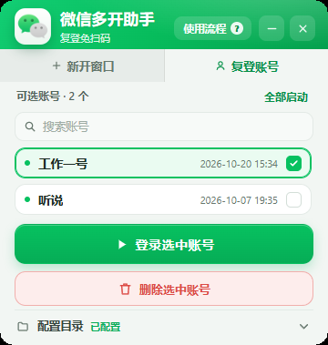

# 微信多开助手

Go + Wails 写的单文件绿色版，界面卡片式，不用安装。
主要功能：**拒绝型互斥体多开** + **保存登录会话免扫码** + **多账号一键启动** + **托盘常驻**。



> 窗口宽度固定 360px、高度跟着内容走；展开「配置目录」时窗口自己长高（docs/screenshot-dirs.png）

---

## 它做什么

| 能力 | 说明 |
| --- | --- |
| 多开 | 程序启动时占住微信的实例互斥体，并把它改成「拒绝所有人访问」，微信判定“没有别的实例”于是每个都能独立启动 |
| 免扫码 | 把已经登录的 `global_config` 存下来；下次启动前先把它预置回微信的配置目录，微信读到旧会话就直接进已登录界面 |
| 多账号 | 一个账号一个目录，下拉框里选谁就启动谁，「全部账号」一次性拉起全部 |
| 托盘常驻 | 关窗口收进托盘，托盘左键唤回、右键菜单退出 |
| 零配置 | 首次运行自动识别微信安装目录和聊天记录目录，识别不到才要你手选（细节见下） |

### 自动识别的来源

**微信安装目录**（四路，按可靠性排，每条候选都要过「存在 `Weixin.exe` 且主版本 ≥ 4」的校验）：

1. `Software\Tencent\Weixin` 的 `InstallPath` / `InstallDir` / `InstallLocation` —— 微信自己写的，免安装版也有（HKCU、HKLM，64/32 位注册表视图都看）
2. `App Paths\Weixin.exe` 的默认值 —— 安装包一般会注册 exe 全路径
3. 卸载表里 `DisplayName` 含「微信 / Weixin / WeChat」的 **`InstallLocation` → `DisplayIcon` → `UninstallString`** —— 装在 `Program Files` 这类系统目录时，`InstallLocation` 经常是空的，只有 `DisplayIcon`（形如 `"...\Weixin.exe",0`），所以三个值都要试
4. 常见根目录下直接找：`%ProgramW6432%`、`%ProgramFiles%`、`%ProgramFiles(x86)%`、`%LOCALAPPDATA%\Programs` 里的 `Tencent\Weixin`、`Weixin`、`Tencent\WeChat`、`WeChat`

> 注册表里的路径写法很杂：带引号、带图标序号（`"...\Weixin.exe",0`）、直接给 exe。统一由 `pathToDir()` 归一成目录，`detect_test.go` 里有一组用例盯着它。

**微信缓存目录**（三路，候选路径本身、父目录、祖父目录都试，因为不同版本记的层级不一样）：

1. `%APPDATA%\Tencent\xwechat\config\*.ini` —— 微信把聊天记录根目录**明文**写在这里（最准）
2. 注册表 `Software\Tencent\Weixin` 的 `FileSavePath` / `DataPath` / `SavePath` / `FileSaveDir`
3. 兜底：`<用户目录>\Documents\xwechat_files`、`<用户目录>\文档\xwechat_files`

判定标准只有一个：该目录下存在 `xwechat_files\all_users\config`。
识别结果会写进 `data\config.ini`，同时记一行到 `data\debug.log`；之后就以 ini 为准，不再覆盖你手选的路径。

**程序自己装在系统目录也行**：`data` 目录默认在 exe 旁边，如果那儿没有写权限（`C:\Program Files\...`），会自动退到 `%LOCALAPPDATA%\微信多开助手\data`，功能一样，日志里会留一行说明。

---

## 快速开始

### 直接编译

```powershell
cd wxmulti-go
.\build.ps1            # 或者看下面手打的三条命令
```

`build.ps1` 做的事就三步（产物落在 `已编译成品\`）：

```powershell
go run ./tools/mkicon app.ico frontend\logo.png   # 生成图标（已生成过可跳过）
go mod tidy
go build -tags desktop,production -trimpath -ldflags "-w -s -H windowsgui" -o ".\已编译成品\微信多开助手.exe" .
```

产物：`已编译成品\微信多开助手.exe`（单文件，约 11 MB）。目录名就叫「已编译成品」——`build` 太像临时目录，容易被顺手清掉（里面还有 `data\`，账号会话在那儿）。

### 运行环境

- Windows 10 / 11 x64
- **WebView2 运行时**：Win11 和装了新版 Edge 的 Win10 都已经自带，没有的话装一次 [Evergreen Runtime](https://developer.microsoft.com/microsoft-edge/webview2/) 即可
- 微信必须是 **4.x**（xwechat 内核，也就是 `Weixin.exe` + `xwechat_files` 那一套）；3.x 的 `WeChat.exe` 不支持

---

## 界面怎么用

界面就两件事：**新开窗口** 和 **复登账号**，顶上一键切换。

### 新开窗口

这一页只有两个并排的按钮，按钮下面一行统计（已保存几个账号 / 最近保存时间）；没有多余的说明卡——流程看标题栏的「使用流程 ?」就够了。

1. 点 **打开登录窗口** → 微信弹出二维码，手机扫码登录。
2. 扫完回到本窗口，点 **保存当前账号**，起个名字（默认按时间生成）。
3. 忘了流程就悬停标题栏右侧那个 **「使用流程 ?」**（在最小化按钮左边），**停够 1 秒**才浮出三步说明（鼠标扫过不会误弹）；点一下是立刻开、按 Esc / 移开鼠标自动收。老手不用管它，新用或久不用的时候瞄一眼就行。

> 气泡是绝对定位的，撑不大窗口；窗口只有 218px 高的时候它会被窗口底边裁掉。WebView 里的东西画不到窗口外面去，所以打开气泡时前端会量出它的底边、**临时把窗口长高**到能装下（218 → 303），收起再缩回去。量的时候用 `offsetTop + offsetHeight` 而不是 `getBoundingClientRect()`：气泡带 140ms 入场动画（`translateY` + `scale`），动画期间 rect 会被 transform 带偏，量出来的高度会 298/303 来回跳。

这一页的「打开登录窗口」和「保存当前账号」是同一行、各占一半、52px 高；复登那页则相反——「登录选中账号」独占一行、**删除选中账号** 在它下面。

### 复登账号

1. 切到 **复登账号**，账号列表直接铺在面板里（可用账号绿点、不完整的橙点并标「配置不完整」），**按保存时间倒序**，最近保存的在最上面。
2. **点一下勾选、再点一下取消**，可以勾多个；按钮会跟着变成「登录 N 个账号」，点一下就把勾选的账号各起一个微信实例，**不用再扫码**。
3. 有两个以上可用账号时，列表右上角会出现 **全部启动**，一次把能用的都拉起来（等价于全勾上）。
4. **删除选中账号** 会把当前勾选的都删掉（只勾一个就是删一个），删除前有二次确认。
5. 账号多了用列表上方的**搜索框**过滤（`Ctrl+F` 或直接按 `/` 聚焦，`Esc` 或点 × 清空）。
6. 键盘：`↑`/`↓` 移动、`空格` 勾选/取消、`Enter` 启动勾选的账号。
7. 两个模式各管各的：**新开窗口**只有「保存当前账号」，**复登账号**只有「删除选中账号」。

### 配置目录（默认收起）

最下面那行左边写着 **配置目录** 和「已配置 / 待配置」，点这一整条展开，窗口会自己长高到合适尺寸，展开后能改两个路径，收起又缩回去。右边那个小药丸 **打开** 直接在资源管理器里打开配置目录（不用先展开）：

- **微信安装目录**：`Weixin.exe` 所在目录（例如 `C:\Program Files\Tencent\Weixin`）
- **微信缓存目录**：包含 `xwechat_files` 的目录（例如 `D:\WeChatFiles`）

展开区最下面还有一条 **账号目录**（`data\allUsersConfig`，一个账号一个文件夹），右边同样有 **打开**。它跟上面两个「要你填的路径」不是一类东西，所以中间用一条实线隔开——上面是配置项，下面是现成的数据目录。

两个 **打开** 不是同一个地方：

| 按钮 | 打开的目录 | 里面是什么 |
| --- | --- | --- |
| 配置目录 → 打开 | `<运行目录>\data` | `debug.log`、`allUsersConfig` |
| 账号目录 → 打开 | `<运行目录>\data\allUsersConfig` | 每个已保存账号一个文件夹（会话文件） |

窗口高度是按内容自适应算的（200–900 之间），账号多了列表自己滚，不会撑破屏幕；底边超出屏幕时会自动往上挪。

### 窗口外形

无边框 + 圆角（半径 14px）。Windows 11 交给系统的 DWM 圆角（带抗锯齿），Windows 10 没有这个能力，就用 `SetWindowRgn` 把窗口裁成圆角区域；窗口高度自适应时会重新裁一次，所以圆角始终跟着窗口走。

宽度固定 **360px**（原来是 480，砍掉 1/4），不能缩放，`MinWidth` / `MaxWidth` 都锁死；高度按内容自适应。360 是顶栏刚好放得下的下限：logo 40 + 标题 + 「使用流程 ?」+ 最小化 + 关闭，副标题因此缩成「复登免扫码」。

顶栏压到 90px（上内边距 14 + logo 40 + 分段控件 36），右侧三个动作按钮（使用流程 / 最小化 / 关闭）用 `align-self: center` 跟着 logo 居中，不靠负 margin 硬顶。

分段控件（新开窗口 / 复登账号）是长在标题栏**里面**的，不是单独一条：整条铺浅灰（`#E7ECE9`），未选中那半就是这条灰；选中那半涂成内容区底色 `--canvas`，看着像这一页签接到下面的内容上。两半之间一条 1px 竖线分隔。

无边框窗口的拖动靠 `--wails-draggable: drag`。Wails 的判断是 `getComputedStyle(mousedown 事件 target)` —— **只看被点中的那个元素**，不看祖先链，所以这个属性必须挂在真正会被点到的节点上。现在挂在整条 `.hdr` 上（自定义属性会向下继承），再把要能点的区域写回 `no-drag`：`.hdr .seg`（两个页签）和 `.hdr .win-actions`（使用流程 / 最小化 / 关闭，气泡也在里面）。原来只在铺底的 `.hdr-layer` 上写了 drag，而它的层级在 `.hdr-content` 下面，永远轮不到它当 target，所以整条标题栏都拖不动。

高度自适应有三条必须守住的规矩，破了窗口不是「跳」就是「底下空一条」：

- `.main` 只裁不滚（`overflow: hidden`）。它要是能滚，切「复登账号」那一瞬间内容比窗口高，溢出和 `scrollIntoView` 就会把整页往上带。
- 整块换内容的操作（切模式、展开目录、首帧）走 `fitNow()`：立刻量、立刻改高度，不等 60ms 防抖。防抖只留给搜索框那种连续输入。
- 量高度不能靠「子元素 `offsetHeight` 相加 + gap 个数」。隐藏的那个 `.panel` 高度是 0，但它照样占一个 gap，于是每次量都多出 12px，全变成窗口底部的空白；负 margin、外边距它也一样看不见。`measureNeeded()` 现在直接取「`main` 的顶 → 最后一块真实内容的底」，中间的 gap 和 margin 一概不管。

顺带一个坑：`.fold-body` 的 `padding-bottom` 不能是 0，否则 `.dir-note` 的 `margin-bottom` 会穿出去，收起时按 `offsetHeight` 扣就少算 2px，窗口会高 2px。

### 窗口图标

无边框窗口默认**没有窗口图标**（`WM_GETICON` 返回 0），任务栏按钮、缩略图预览、Alt+Tab 就会各自回退到系统缓存里的旧 exe 图标。所以程序启动时会显式调 `WM_SETICON`，把 `app.ico` 里的 32px / 16px 图设成窗口大/小图标（句柄在整个窗口生命周期内持有，退出时释放）：

```go
// internal/syswin/syswin.go
SetWindowIcons(core.AppName, appICO)   // OnStartup 里调用
```

这样任务栏那一套全部拿的是我们自己的图标，不用再赌系统缓存。

各尺寸长什么样、字有没有压到气泡，看 `docs/icon-sheet.png`（上排原尺寸、下排 4 倍放大）。要重出这张对照图：`$env:MKICON_SHEET="docs\icon-sheet.png"; go run ./tools/mkicon app.ico frontend\logo.png docs\icon-256.png`。
### 窗口与托盘

- 点 `—` 或按 `Alt+F4`：收进托盘（托盘左键唤回，右键菜单退出）
- 点 `✕`：直接退出程序
- 托盘右键菜单三项：**显示主窗口** / **开机自启动**（勾选态，点一下切换）/ **退出程序**。开机自启动写的是 `HKCU\Software\Microsoft\Windows\CurrentVersion\Run` 里名为「微信多开助手」的值，值是指向当前 exe 的带引号路径；关闭就是删掉这个值。走 HKCU 所以不需要管理员权限，也只影响当前用户。
- 菜单是**自己画**的，不是系统 `TrackPopupMenu`：系统那套画出来是直角 + 系统灰配色，没法改。自绘方案（`internal/syswin/traymenu.go`）开一个 `WS_POPUP` 小窗，白底、圆角（Win10 用 `SetWindowRgn` 裁，Win11 交给 DWM）、悬停淡绿高亮、勾选项前面画绿色 ✓，还带 `CS_DROPSHADOW` 投影。点中 / `ESC` / 点到别处都会销毁窗口，用局部消息循环收尾。
- 退出时**先把托盘图标摘掉**再退：`Shell_NotifyIcon(NIM_DELETE)` 放在 `runtime.Quit` 之前调。等 `OnShutdown` 再删的话，WebView 拆起来要时间，进程退了图标还可能赖在通知区域里，得等鼠标划过才消失。
- 启动时看账号目录里有没有账号：有就停在 **复登账号** 页（顺带把第一个可用账号勾上），一个都没有才停 **新开窗口**。判断依据是账号文件夹在不在，不看会话是否完整 —— 会话坏了的账号也得能看见、好去删。

---

### 图标

底图是官方微信双气泡（`assets/wechat-mark.png`，原始素材 `assets/wechat-mark.webp`），`tools/mkicon` 把它裁掉透明边、按比例缩放，右上角加「多开」：

```
go run ./tools/mkicon app.ico frontend\logo.png
```

- `app.ico`：9 个尺寸（16/20/24/32/40/48/64/128/256），exe 图标（经 `rsrc -ico app.ico -o rsrc.syso`）和托盘图标都用它；**每个尺寸都带「多开」**，字号按尺寸分档（≤32px 用 0.26 倍、33–63px 用 0.195 倍、≥64px 用 0.15 倍），≤32px 不描白边（笔画只有 1–2px，描边会把字吃掉）
- `frontend/logo.png`：铺白底圆角板、不带文字，给界面左上角 34px 显示用（透明底的话绿气泡贴在绿色头部上会看不见）
- 换底图：把新图放进 `assets/` 后用 `MKICON_MARK=assets/xxx.png go run ./tools/mkicon ...`；webp 素材可以先用 `go run ./tools/webp2png in.webp out.png` 转一下
- 中文字体自动从 `C:\Windows\Fonts` 找（雅黑 Bold → 雅黑 → 黑体 → 等线 Bold → 宋体），找不到就只画气泡
## 数据目录

全部数据都在 exe 同级的 `data` 里，可以直接打包带走：

```
微信多开助手.exe
data/
├─ config.ini                 # [path] install= / cache=
├─ allUsersConfig/            # 一个子目录 = 一个已保存账号
│  └─ 我的大号/
│     ├─ global_config        # 微信的加密会话文件（等于登录态，别外传）
│     ├─ global_config.crc
│     └─ _meta.json           # 保存时间 / 微信版本，仅供界面显示
└─ debug.log                  # 启动自检日志（互斥体/托盘/目录识别）
```

> 目录结构保持稳定：换机器或升级时，把 `data\allUsersConfig\*` 拷过来就能直接用。

---

## 工作原理（30 秒版）

```
启动本程序
  └─ CreateMutexW("XWeChat_App_Instance_Identity_Mutex_Name")
      └─ 把 DACL 改成「Everyone 拒绝 0xFFFFF」，句柄一直握着
          └─ 之后再启动多少微信，微信自己都拿不到这个互斥体（ACCESS_DENIED 被它当成“没有实例”）

点「启动微信」
  ├─ 清掉 <缓存目录>\xwechat_files\all_users\config\global_config(+.crc)   ← 先改名再删，绕开微信的文件占用
  ├─ 如果指定了账号：把 data\allUsersConfig\<账号>\global_config(+.crc) 复制进去
  ├─ ShellExecute(Weixin.exe)
  ├─ 等 2 秒（微信这时已经把会话读进内存了）
  └─ 再清一次，避免这份会话文件被后面启动的实例复用
```

---

## 常见问题

**提示“目录中没有 xwechat_files\all_users\config”**
缓存目录要选 `xwechat_files` 的**父目录**，不是 `xwechat_files` 本身，也不是 `%APPDATA%\Tencent\xwechat`。

**自动识别不出来怎么办**
- 安装目录没识别到：多半是绿色版/免安装版，注册表里没有记录 → 点「选择」手选到 `Weixin.exe` 那一层。
- 缓存目录没识别到：微信从没登录过（`%APPDATA%\Tencent\xwechat\config\` 里没有 ini），或者数据目录在移动硬盘/网络盘上 → 手选到含 `xwechat_files` 的目录。
- 想让它重新识别：删掉 `data\config.ini` 再启动，会重新走一遍识别。

**提示“找不到 global_config（微信是否已登录过？）”**
「保存当前账号」要在某个微信实例已经登录之后点。没登录过的时候微信根本不会生成这个文件。

**账号很多时列表怎么显示**
列表最多显示 5 行（`max-height: 208px`，行高 34px），再多就在列表内部滚动，窗口高度不再继续长；标题会写「可选账号 · N 个」，右上角出现「全部启动」（≥2 个可用账号时才有）。进界面时会把当前选中的账号自动滚进可视区；键盘 `↑`/`↓` 换选中、`Enter` 直接启动选中账号。效果见 `docs/screenshot-many.png`（10 个账号的样子）。
**点「保存当前账号」提示“缓存目录里没有 global_config”**
微信只在登录状态变化时写这个文件。先点「打开登录窗口」扫码登录一个微信号，再回来保存。
另外工具自己清理旧配置时会把 `global_config` 改名成 `global_configX`（微信占着删不掉），所以缓存目录里可能只剩 `global_configX`/`global_configX.crc` —— 这种情况保存会自动用这两个当来源，提示里会写「来源：global_configX（上次清理改名留下的副本）」，不用你手动改回去。
**展开 / 收起「配置目录」时上面的内容会跳一下？**
已修，两个方向都稳：
1. 原来那行用 `margin-top: auto` 钉在窗口底部，展开时内容先变高、它先被顶上去，窗口长高后又落回来 → 抖一下。现在改成内容自上而下顺排（多余空间交给末尾弹性占位块），窗口只向下生长。
2. 收起时原来是「先隐藏内容、窗口后缩」，中间会出现一段 123px 的空白再消失 → 反而更明显。现在改成「先把目录内容设成隐形但保留占位 → 把窗口缩到位 → 再真正隐藏」，肉眼只看到窗口底边上移，上半部分不动。
3. 顺带修了分割线外边距被算两遍导致的 2px 整体偏移。

现在的做法是「窗口先缩到位、内容再消失」：收起时先把目录内容设成 `visibility:hidden`（仍占布局），量出收起后的高度立刻 `FitHeight`，等窗口缩完再真正 `display:none`。展开同理（`render()` + `fitNow()` 同一帧完成），所以两种状态下上面那些元素的纵向坐标完全一致，一个像素都不动。
**多开没生效 / 第二个微信被激活到第一个窗口**
确认程序还在运行（它必须一直握着互斥体）。如果先启动了微信、后启动本程序，本程序抢占互斥体后也能多开；但微信换成新版本改了实例校验方式的话，这个招会失效。

**启动后只提示「已启动 N 个微信实例」，旧配置真清掉了吗**
多开时微信一定正攥着 `global_config.crc`，改名/删除被拒是常态，所以界面不再为此弹提示，只有启动真的失败才报错。细节都记在 `data\debug.log`，形如「启动 新建扫码 提示（多开时清理失败属正常）：…Access is denied.」。工具每次清理前会顺手再试删上次留下的 `global_configX` 残骸，等微信全退过一次就会自动带走。

**改了图标但任务栏 / 资源管理器还是老样子**
exe 里的图标是新的（`rsrc -ico app.ico -o rsrc.syso` → `go build`），但 Windows 会缓存图标。清缓存：

```powershell
Stop-Process -Name explorer -Force            # 会关掉所有资源管理器窗口
Remove-Item "$env:LOCALAPPDATA\Microsoft\Windows\Explorer\iconcache*.db" -Force
Start-Process explorer
```

一般重启资源管理器就够了；实在不行把 exe 换个路径/改个名，新路径必然重新取图标。
**托盘图标没了**
任务栏重启（explorer 崩溃）后图标会消失，程序已经监听 `TaskbarCreated` 自动补回；如果还是没有，看 `data\debug.log`。

**杀软报毒**
程序做了三件杀软敏感的事：改互斥体 DACL、写别的程序目录、ShellExecute 启动外部 exe。源码全在这里，自己 `go build` 一遍再运行最稳，也可以给 exe 加信任。

**能多开到几个？**
看机器内存。每个实例是完整的 Electron 级进程树（主进程 + 若干子进程），3～5 个比较舒服。

---

## 目录结构（源码）

```
wxmulti-go/
├─ main.go                 # wails.Run 启动、窗口参数、单实例锁
├─ app.go                  # 绑定给前端的后端：状态/目录/启动/账号/托盘
├─ internal/
│  ├─ core/                # 业务：config.ini、账号仓库、启动时序、目录自动识别
│  └─ syswin/              # 原生：拒绝型互斥体、文件版本、ShellExecute、托盘、ICO
├─ frontend/               # index.html + style.css + app.js（无构建步骤，直接 embed）
├─ tools/mkicon/           # 图标生成器（Go 画的多尺寸 ICO + logo.png）
├─ tools/statecheck/       # 排障用：go run ./tools/statecheck "已编译成品" 打印后端状态
├─ assets/                 # 图标底图（wechat-mark.png 是 mkicon 的输入，.webp 是原始素材）
├─ app.ico / rsrc.syso     # exe 图标资源
├─ 已编译成品/              # 编译产物：微信多开助手.exe + data/（config.ini、账号会话、debug.log）
├─ docs/screenshot.png / -dirs / -many   # 界面、展开配置目录、多账号（都是当前 360px 版的实拍）
├─ docs/icon-256.png / icon-sheet.png    # 图标各尺寸对照（MKICON_SHEET=... 可重新生成）
└─ build.ps1
```

---

## 注意

- `global_config` 就是**登录态**（加密的，但能直接换机器免扫码），别发给别人。
- 本工具只在本机复制/删除微信自己的配置文件，不联网、不改微信程序本体。
- 微信改版可能让这套办法失效，到时候要重新分析新版的实例校验与会话文件位置。
---

## 许可证

代码用 **MIT**，见 [LICENSE](LICENSE)：随便用、改、商用、再发布，保留版权声明即可，作者不担责任。

两个例外得说清楚：

- `assets/wechat-mark.*` 是微信官方图标，属于腾讯的商标/著作权，**不在 MIT 覆盖范围内**，只作为本工具的图标底图引用。要公开发布或商用，建议换成自己画的图标（`tools/mkicon` 读这个文件生成 ICO，换个图跑一遍即可）。
- 「微信」「WeChat」是腾讯的商标，本项目与腾讯无关，也不是官方工具。

用这个工具批量登录/多开账号，风险（包括但不限于违反微信用户协议导致账号受限）由使用者自己承担。
